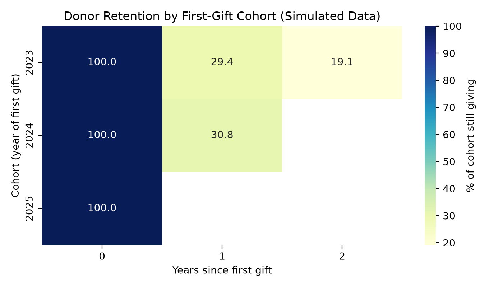
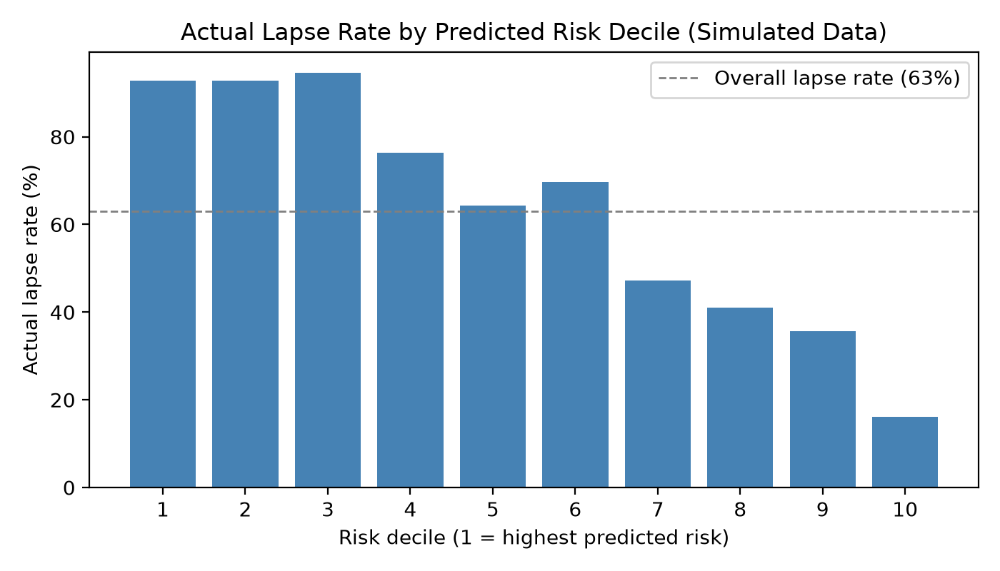
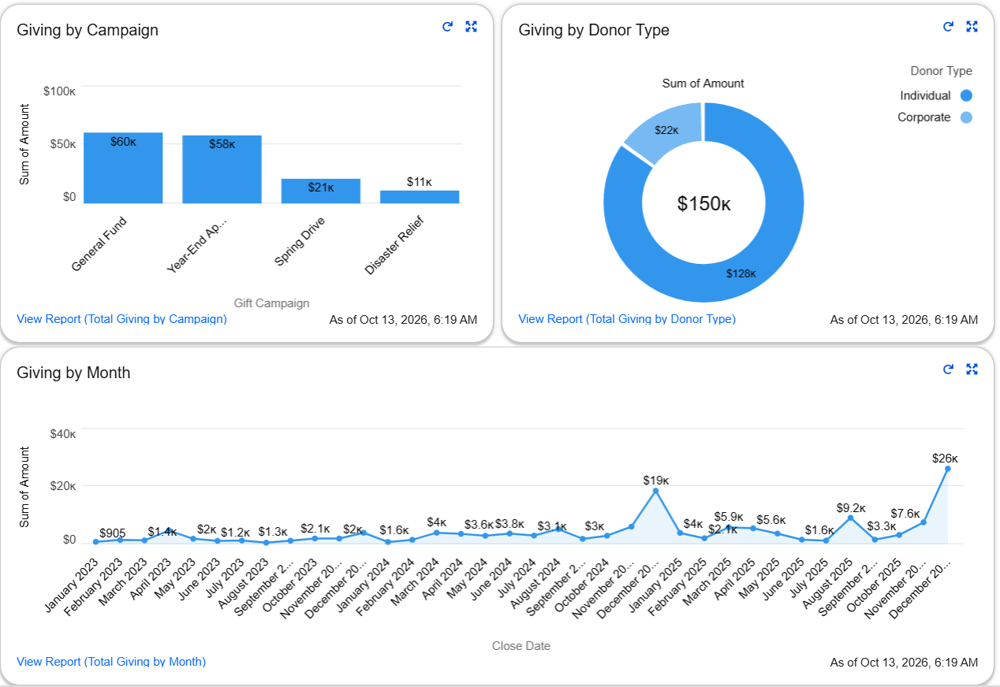

# Donor Retention & Lapse Analysis

`Python` · `PostgreSQL` · `scikit-learn` · `Salesforce`

**Which donors will a nonprofit lose, and which are worth winning back?**

Fundraising teams lose most first-time donors and depend on a small group of loyal and major givers. This project builds an end-to-end analysis (Python, PostgreSQL, machine learning, Salesforce) that shows who stops giving, where the lost value sits, and where outreach should go first.

**[Full report (PDF)](report/Donor_Retention_Lapse_Analysis_Report.pdf)** | **[Slides (PowerPoint)](presentation/Donor_Retention_Lapse_Analysis_PPT.pptx)**

> **Note:** All data is simulated, for learning and portfolio use. Results demonstrate the method, not a real organization.

## Key Results

| Finding | Result | Recommended action |
|---|---|---|
| First-year retention | About 30% of new donors give again (29.4% for the 2023 cohort, 30.8% for 2024) | Thank-you and second ask soon after the first gift |
| Lapsed value is concentrated | 77 of 1,405 lapsed donors (about 5%) hold half of lapsed giving (about $106K) | Personal outreach to the top 77, lighter touch for the next few hundred |
| Growth depends on new donors | 62% of 2025 giving came from returning donors, and each older cohort shrinks every year | Track retention by cohort |
| Seasonality | November and December bring in about 35% of annual giving | Plan the Year-End Appeal early |
| Lapse is predictable | ROC-AUC 0.82. The highest-risk 30% of donors lapse at about 94%, the lowest-risk 10% at 16% | Rank outreach by risk and past giving |

| Cohort retention | Lapse rate by risk decile |
|---|---|
|  |  |
| Share of each signup cohort still giving in later years | Actual lapse rate for each band of predicted risk |

## Skills Demonstrated

- **SQL (PostgreSQL):** CTEs, window functions, self-joins, anti-joins, cohort analysis, data quality validation
- **Python:** pandas, NumPy, matplotlib, seaborn, reproducible data simulation
- **Machine learning:** logistic regression and random forest in scikit-learn, with leakage-safe features and ROC-AUC and lift evaluation
- **Analytics:** retention and cohort analysis, Pareto analysis, seasonality
- **Salesforce:** data modeling, data import, reports and dashboards

## Approach

1. **Simulate** 5,000 donors and 8,816 gifts in Python.
   Hidden donor segments (one-time, occasional, loyal, major) drive giving behavior. They are not stored in the data, so the analysis has to find the patterns.
2. **Load and validate** the data in PostgreSQL.
   Checks cover row counts, nulls, duplicates, and referential integrity.
3. **Analyze** retention, cohorts, lapsed donors and campaigns with SQL.
4. **Visualize** the results in Python.
5. **Predict** lapse risk with a model trained only on pre-2025 giving history.
6. **Cross-check** every key metric between Python and SQL. All matched.

Because the generating rules are known, the method can be tested against them. The simulation settings predict about 29.2% first-year retention, and the analysis measured 29.4% and 30.8%.

## Extension: Salesforce CRM Build

A 500-donor sample (901 gifts) was loaded into a Salesforce Developer org: donors as Accounts, gifts as Opportunities linked by an external ID, with three reports and a dashboard. The sample files are in `salesforce/`, and the build is described in Section 8 of the report.



*Salesforce dashboard built on the 500-donor sample.*

## Repository Structure

```text
├── donor_analysis.ipynb     # data simulation, validation and charts
├── lapse_prediction.ipynb   # lapse risk model
├── requirements.txt
├── data/                    # donors.csv, gifts.csv
├── sql/                     # 01 schema and checks, 02 retention and lapse, 03 cohort and campaign
├── charts/                  # PNG charts
├── report/                  # full written report (PDF)
├── presentation/            # slide deck (PowerPoint)
└── salesforce/              # CRM extension files
```

## How to Run

1. Install dependencies:
   ```bash
   pip install -r requirements.txt
   ```
2. Run `donor_analysis.ipynb` top to bottom. It creates the CSVs in `data/` and the charts in `charts/`.
3. In PostgreSQL, set up the database:
   - Run `sql/01_schema_and_data_quality.sql` to create the tables
   - Load `donors.csv`, then `gifts.csv`
   - Run the data quality checks at the end of the same file
4. Run `sql/02_retention_and_lapse_analysis.sql` and `sql/03_cohort_and_campaign_analysis.sql`.
5. Run `lapse_prediction.ipynb` to train and evaluate the model.

## Limitations

- **Simulated data:** findings demonstrate the method, not real donor behavior.
- **Built-in patterns:** the model recovers patterns built into the simulation, so it confirms the method rather than discovering new behavior.
- **Snapshot definition:** a donor who gave in 2024 but not 2025 is counted as lapsed but may return later.
- **Descriptive only:** the analysis shows what happened. It does not prove that an outreach change would work, which would need an A/B test.

## Next Steps with Real Data

RFM scoring, outreach A/B tests, time-based model validation, and a BI dashboard for cohort tracking.

---

Author: Imane Khtib | [khtibimane23@gmail.com](mailto:khtibimane23@gmail.com)
